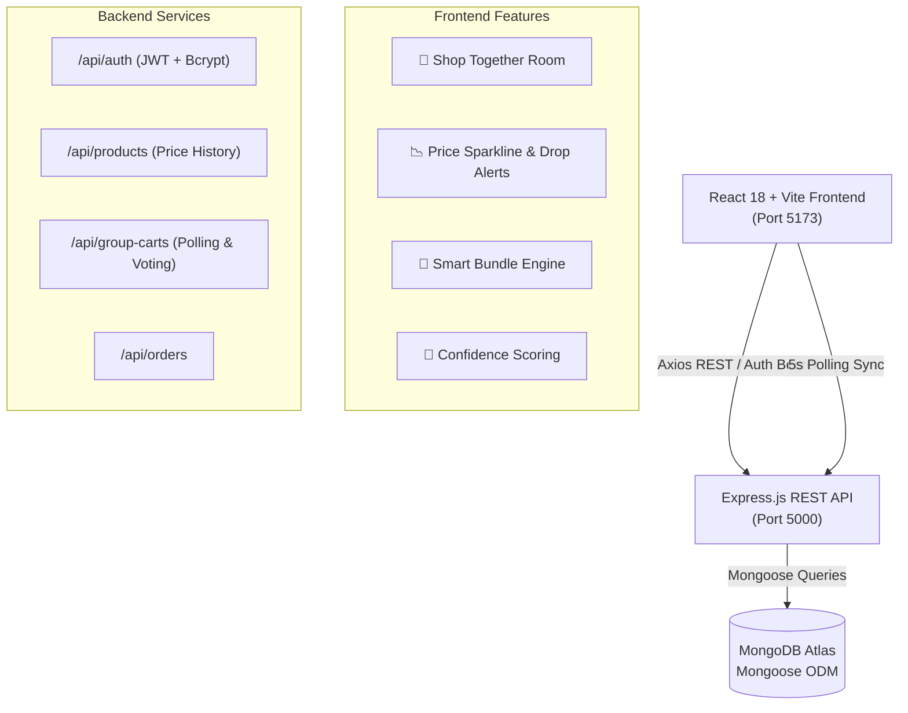

# 🛍️ SmartCommerce — Next-Gen Product Intelligence & Social Commerce

<p align="center">
  
</p>

<p align="center">
  
  
  
  
  
  
</p>

---

## 📖 Overview

**SmartCommerce** is a full-stack MERN e-commerce application designed to move beyond traditional storefront templates. Built with a sleek dark glassmorphism UI, it integrates **collaborative group purchasing**, **intelligent setup bundling**, **historical price memory tracking**, and **purchase confidence scoring**.

---

## 🌟 Key Differentiating Features

### 1. 👥 Shop Together (Shared Group Cart)
> *Collaborative shopping designed for roommates, group trips, and joint gifts.*

- 🔗 **Instant Invitation Link**: Host creates a shared session and gets an invite code/URL (`/group-cart/ABC123`).
- ⚡ **Real-Time 5-Second Polling**: Synchronizes cart contents, member presence, and total prices automatically without socket setup overhead.
- 👍 **Democratic Item Voting**: Friends can vote **Thumbs Up (👍)** or **Thumbs Down (👎)** on each added item to reach group consensus before buying.
- 🔒 **Host Control & Checkout**: Cart host can lock the cart to prevent edits and seamlessly initiate checkout.

---

### 2. 📉 Price Memory & Drop Watch
> *Transparent price tracking that empowers buyers and rewards patience.*

- 📊 **30-Day Historical Sparkline**: Pure SVG interactive trend graphs rendered directly on product pages and admin consoles.
- 🏷️ **"Lowest in 30 Days" Dynamic Badge**: Automatically calculated from historical database timestamps.
- 🎯 **Target Price Watch**: Users can set their desired price threshold on any product.
- 🔔 **Dashboard Drop Alerts**: Instant banner with 1-click **"Add to Cart at Discount"** when prices drop below the watched target.
- 🛠️ **Admin Price Manager (`/admin/products`)**: In-line price editor with automatic historical timestamping and trend visualization.

---

### 3. 🧩 Smart Bundle Builder
> *Tag-based intelligent accessory pairing that increases average order value.*

- 🔍 **Dynamic Cross-Recommendations**: Analyzes complementary accessories and workspace gear matching the viewing product.
- 💰 **12% Setup Bundle Savings**: Live pricing breakdown with individual vs. bundle discounted rate.
- ⚡ **One-Click Add-to-Cart**: Adds the entire recommended 4-item setup in a single action.

---

### 4. 🎯 Purchase Confidence Panel
> *Deterministic scoring metric providing complete shopper transparency.*

- 📐 **Tri-Metric Breakdown**: Value Score, Review Sentiment, and Delivery Confidence (0–100 index).
- 🚚 **Delivery & Return Assurance**: Clear turnaround days, return policies, and verified review highlights.

---

## 🔐 Demo Accounts & Roles

| Role | Email | Password | Permissions |
|---|---|---|---|
| 👑 **Admin** | `admin@smartcommerce.com` | `admin123` | Full Store Access, Admin Price Manager (`/admin/products`), Historical Price Editing |
| 👤 **Demo User** | `demo@smartcommerce.com` | `user123` | Dashboard, Price Watches, Group Carts, Order History |
| 🌐 **Guest** | *No login needed* | *N/A* | Browse Catalog, Smart Bundles, Guest Cart, Checkout, Join Shared Carts |

*(💡 Quick demo credentials buttons are provided directly on the `/login` page for fast review!)*

---

## 🏗 System Architecture



---

## 🚀 Quick Setup Guide

### 1. Clone the repository
```bash
git clone https://github.com/<your-username>/smart-commerce.git
cd smart-commerce
```

### 2. Backend Setup
```bash
cd server
npm install

# Create .env from the example template
cp .env.example .env
```
*Configure your MongoDB URI and JWT Secret in `server/.env`:*
```env
MONGO_URI=mongodb+srv://<username>:<password>@cluster.mongodb.net/smartcommerce?retryWrites=true&w=majority
JWT_SECRET=your_jwt_secret_key_here
PORT=5000
```

*Seed mock products, price history, and default demo accounts:*
```bash
node seed.js
```

*Start backend development server:*
```bash
npm run dev
```

### 3. Frontend Setup
```bash
cd ../client
npm install
npm run dev
```
Open **http://localhost:5173** in your browser!

---

## 📡 REST API Reference

| Endpoint | Method | Auth | Description |
|---|---|---|---|
| `/api/auth/register` | `POST` | Public | Register user account |
| `/api/auth/login` | `POST` | Public | Login with email & password |
| `/api/auth/me` | `GET` | Bearer | Get authenticated user info & price watches |
| `/api/products` | `GET` | Public | List products (with category, search, sorting) |
| `/api/products/:id` | `GET` | Public | Get single product + price history |
| `/api/products/:id/price` | `PUT` | Admin | Update price and append to `priceHistory` |
| `/api/products/:id/watch` | `POST` | User | Watch target price for drop alerts |
| `/api/group-carts` | `POST` | Public | Create new collaborative group cart |
| `/api/group-carts/:code` | `GET` | Public | Fetch group cart state (for 5s polling) |
| `/api/group-carts/:code/join` | `POST` | Public | Join shared group cart session |
| `/api/group-carts/:code/items` | `POST` | Public | Add item to group cart |
| `/api/group-carts/:code/items/:id/vote` | `POST` | Public | Cast 👍 / 👎 vote on item |
| `/api/group-carts/:code/lock` | `PATCH` | Host | Lock group cart for final checkout |
| `/api/orders` | `POST` | Public | Place order |
| `/api/orders` | `GET` | Public/User | Fetch order history |

---

## 💻 Tech Stack Summary

- **Frontend**: React 18, Vite, Tailwind CSS, Lucide React, React Router DOM v6.
- **Backend**: Node.js, Express.js, JSON Web Tokens (JWT), Bcrypt.js, CORS.
- **Database**: MongoDB Atlas, Mongoose ODM.
- **State & Storage**: React Context API, LocalStorage Session Persistence, REST Polling.

---

## 📄 License
This project is open source and available under the [MIT License](LICENSE).
